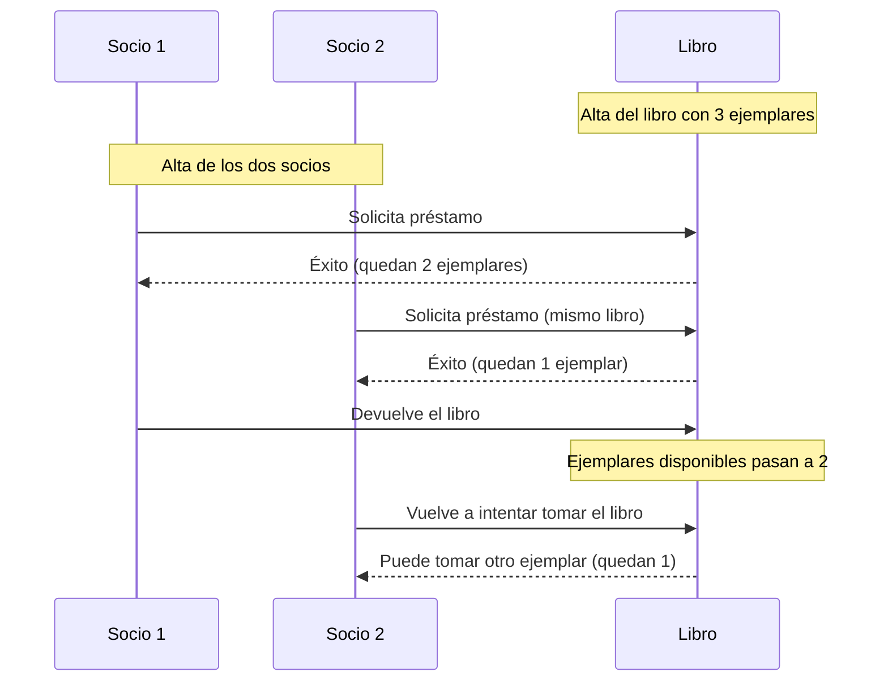

# Solución Ejercicio 1 — Diseño con Tarjetas CRC

## Ejercicio 1 — Diseño con Tarjetas CRC

### Tarjeta CRC: `Libro`

| Clase: Libro | |
|---|---|
| **Responsabilidades** | **Colaboradores** |
| Conocer su título, autor e ISBN | — |
| Conocer el número de ejemplares disponibles | — |
| Prestar un ejemplar (si hay disponibles) | `Préstamo` |
| Recibir la devolución de un ejemplar | `Préstamo` |

### Tarjeta CRC: `Socio`

| Clase: Socio | |
|---|---|
| **Responsabilidades** | **Colaboradores** |
| Conocer su nombre, número de socio y fecha de alta | - |
| Solicitar el préstamo de un libro | Prestamo, Libro |
| Devolver un libro presado | Prestamo |

### Tarjeta CRC: `Prestamo`

| Clase: Prestamo | |
|---|---|
| **Responsabilidades** | **Colaboradores** |
| Conocer que libro y qué socio están implicados | Libro, Socio |
| Conocer la fecha de inicio del prestamo | - |
| Registra la devolucion del préstamo | libro |

## 2. Relación entre las clases

**Qué ocurre al intentar prestar un ejemplar:**

1. Se comprueba si `Libro` tiene ejemplares disponibles (> 0).
2. Si los hay: se descuenta un ejemplar disponible y se crea un `Préstamo` que relaciona ese `Libro` con el `Socio`. La operación se considera con éxito.
3. Si no los hay: no se crea el préstamo y no se modifica el número de ejemplares. La operación se considera fallida.

Al **devolver** un libro, ocurre lo contrario: el `Préstamo` se marca como finalizado y `Libro` incrementa en uno su número de ejemplares disponibles.

## 3. Flujo paso a paso

> Nota: como el libro tiene 3 ejemplares, ambos socios pueden tomarlo prestado sin que se agoten. El ejercicio busca que se razone sobre el control de disponibilidad, no que el segundo intento del Socio 2 falle necesariamente — dependerá de cuántos ejemplares queden en cada paso.
